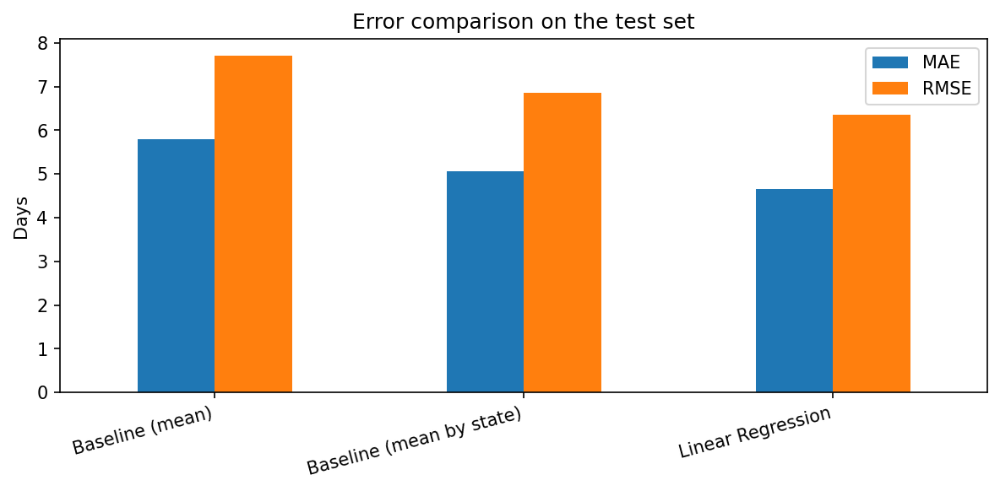
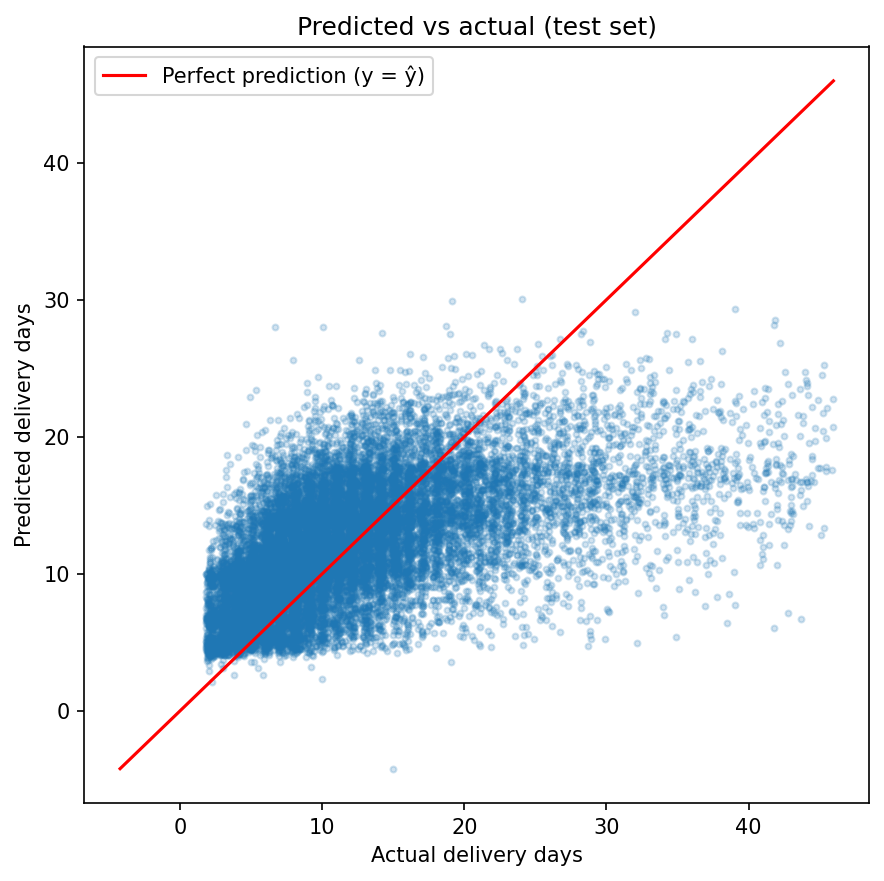
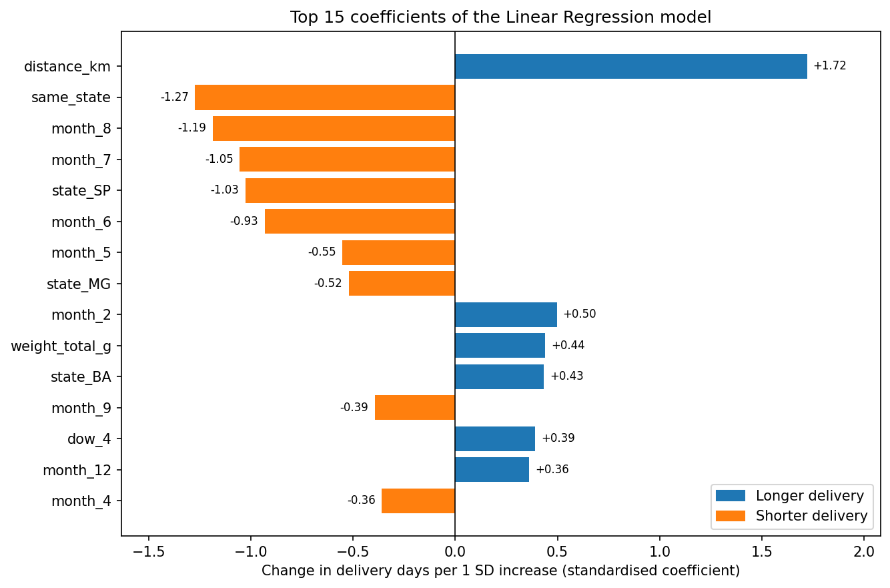

# Olist Delivery Time Prediction with Linear Regression

Course project for *Data Analysis with Python* (National Economics University, Hanoi, Faculty of Data Science and AI).  
Instructor: PhD. Tran Duc Minh.

**Authors:** Nguyen Thi Tra My, Do Huyen Trang, Le To Huong Giang

---

## 1. Business Question & Problem Formulation

To what extent can we estimate delivery days using only information available at the moment an order is placed (checkout time)?

- **Target ($y$):** `delivery_days` = `order_delivered_customer_date` − `order_purchase_timestamp` (in calendar days).
- **Features ($X$):** 50 features after preprocessing, derived strictly at checkout time:
  - Seller–customer distance (straight-line Haversine distance, using median coordinates per zip-code prefix; max distance is taken for multi-seller orders)
  - Same-state shipping indicator (`same_state`: equals 1 if all items in the order come from the customer's state)
  - Order-level aggregates: total weight (`weight_total_g`), total volume (`volume_total_cm3`), total freight (`total_freight`), total item price (`total_price`), total item count (`item_count`)
  - Categorical variables (one-hot encoded, dropping the first level as reference): customer state (26 dummies, reference: Acre - AC), purchase month (11 dummies, reference: January), purchase day of week (6 dummies, reference: Monday).
- **Leakage Prevention:** Any post-order data (`order_delivered_carrier_date`, `order_delivered_customer_date`, customer reviews) is strictly excluded.
- **Design Choice on Existing Estimate:** Olist's `order_estimated_delivery_date` was deliberately excluded from predictors; because it is already a prediction, including it would reduce the problem to re-predicting an existing estimate rather than building a baseline from raw checkout features.

---

## 2. Dataset

The project uses the [Olist Brazilian E-Commerce Public Dataset](https://www.kaggle.com/datasets/olistbr/brazilian-ecommerce) on Kaggle (~100,000 orders from 2016 to 2018 across Brazil).

The notebook downloads the dataset automatically with `kagglehub`; no manual download is needed.

---

## 3. Methodology & Workflow

1. **Data Cleaning & Consolidation:**
   - Filter `order_status == 'delivered'` and drop orders missing delivery timestamps.
   - Filter coordinates outside Brazil; aggregate geographic coordinates using the median latitude and longitude per `geolocation_zip_code_prefix`.
   - Drop 465 orders with unresolvable coordinates.
   - Trim delivery time to the 1st–99th percentile range (1.83 to 46.05 days).
   - Final dataset consists of **94,075 orders** across **50 features** (see detailed audit in `results/cleaning_table.csv`).
2. **Train/Test Split:**
   - 80/20 random split (`random_state=42`): **75,260 train** orders and **18,815 test** orders.
   - Missing value imputation (`SimpleImputer(strategy='median')`) and standardization (`StandardScaler`) fitted strictly on training data inside a scikit-learn Pipeline.
3. **Multicollinearity & Variable Selection:**
   - Checked pairwise correlations and Variance Inflation Factors (VIF). High correlation between `weight_total_g` and `volume_total_cm3` ($r = 0.831$) was retained as both VIF values remained under 4.0 (see `results/x_selection_vif.csv`).
4. **Model Benchmarking:**
   - Benchmarked against two baselines: Global-mean baseline and Customer-state-mean baseline.
5. **Statistical Diagnostics & Robust Standard Errors:**
   - Evaluated residual normality (Q-Q plot), tested error variance homogeneity using Breusch-Pagan, and computed HC3 heteroscedasticity-robust standard errors.

---

## 4. Key Results

### 4.1. Model Performance (Test Set)

| Model | MAE (days) | RMSE (days) | $R^2$ | Within 3 days | Within 5 days |
|---|:---:|:---:|:---:|:---:|:---:|
| **Baseline (Global Mean)** | 5.803 | 7.700 | -0.000 | 31.1% | 52.1% |
| **Baseline (Mean by State)** | 5.062 | 6.855 | 0.207 | 38.1% | 61.0% |
| **Linear Regression** | **4.651** | **6.349** | **0.320** | **42.4%** | **65.4%** |

Linear Regression reduces MAE by **19.9%** (1.15 days) and RMSE by **17.5%** (1.35 days) relative to the global mean baseline. Training $R^2$ (0.326) and test $R^2$ (0.320) are closely aligned, showing no sign of overfitting.



### 4.2. Prediction Accuracy & Residuals

- 42.4% of test orders are predicted within 3 days of actual delivery; 65.4% within 5 days.
- Long deliveries are systematically underestimated and short ones overestimated because predictions are compressed toward the mean when $R^2$ is about 0.32.



### 4.3. Key Drivers & Coefficient Interpretation

- **Distance (`distance_km`):** Strongest positive continuous predictor (+0.29 days per 100 km, $b = 0.0029, p < 0.001$).
- **Same-State Shipping (`same_state`):** Predicts an arrival approximately **2.66 days sooner** when all items in the order originate from the customer's state ($b = -2.66, p < 0.001$).
- **Customer State (relative to Acre - AC):** Holding distance and same-state constant, orders to São Paulo (SP: -2.08 days) and Minas Gerais (MG: -1.60 days) arrive earlier than the remote reference state Acre (AC). In contrast, orders to Bahia (BA: +2.37 days), Alagoas (AL: +5.35 days), Amazonas (AM: +5.58 days), and Amapá (AP: +4.69 days) arrive later. *Note: States such as AM, AL, and AP have very few orders, so their coefficients are less reliable and serve primarily as descriptive reference.*
- **Statistical Significance (Classical vs HC3):** Under classical OLS standard errors, 30 out of 51 parameters (50 features + intercept) are statistically significant at $p < 0.05$. Because the Breusch-Pagan test indicates severe heteroscedasticity ($LM = 3,668, p < 0.001$), HC3 robust standard errors were computed; 29 out of 51 parameters remain significant under HC3, with `total_price` losing significance ($p = 0.0237 \rightarrow p = 0.0528$).



---

## 5. Limitations

1. **Unexplained Variance:** About 68% of the variation is not explained by checkout-time features (e.g., seller processing time, carrier, product category, holidays and weather are not in the model).
2. **Percentile Trimming:** The 1st and 99th percentile thresholds (1.83–46.05 days) were computed on the full dataset before the train–test split, so the test set had a minor influence on trimming boundaries.
3. **Temporal Mixing:** Month effects bundle seasonality, yearly differences, and one-off events because the data span October 2016 to August 2018 (with only 258 orders in 2016; September–December are observed almost exclusively in 2017).
4. **Random Split Overlap:** Because the 80/20 split was random, train and test sets share the same calendar months and events; model performance on future time periods may be lower.
5. **Linear Model Extrapolation:** The model is linear and additive without interactions; it can produce impossible predictions (one test prediction is approximately -4 days).
6. **Residual Heteroscedasticity & Asymmetry:** Residuals are right-skewed with non-constant variance, meaning confidence intervals and p-values are approximate.
7. **Association vs Causality:** Regression coefficients show observational associations rather than causal effects.

---

## 6. Repository Structure

```
.
├── code.ipynb                     # Full analysis, data processing, and modeling notebook
├── figures/                       # Exported charts (high-resolution PNGs)
│   ├── 01_distribution_of_y.png
│   ├── 02_correlation_matrix.png
│   ├── 03_delivery_time_by_state.png
│   ├── 04_review_vs_delivery.png
│   ├── 05_model_comparison.png
│   ├── 06_predicted_vs_actual.png
│   ├── 07_residual_qq.png
│   ├── 08_residual_plot.png
│   ├── 09_qq_plot.png
│   └── 10_top15_coefficients.png
├── results/                       # Exported analytical summaries (CSVs)
│   ├── cleaning_table.csv         # Step-by-step order filtering audit
│   ├── delivery_time_by_state.csv # Mean delivery days per state
│   ├── error_tolerance.csv        # Proportion within 3 and 5 days
│   ├── model_comparison.csv       # MAE, RMSE, R2 comparison table
│   ├── ols_coefficients.csv       # Full OLS regression coefficient table
│   ├── ols_coefficients_hc3.csv   # Classical vs HC3 robust inference
│   ├── state_coefficients.csv     # State dummy coefficients
│   ├── table1_raw_tables.csv      # Dimensions and missing values of raw tables
│   └── x_selection_vif.csv        # Correlation and VIF diagnostic table
├── report/
│   └── report.pdf                 # Written project report
├── requirements.txt               # Python package dependencies
├── .gitignore
└── README.md                      # Project documentation
```

---

## 7. How to Run

### Setup Environment

```bash
# 1. Create and activate a virtual environment
python -m venv .venv
source .venv/bin/activate          # On Windows: .venv\Scripts\activate

# 2. Install dependencies
pip install -r requirements.txt

# 3. Launch JupyterLab
jupyter lab
```

### Running the Notebook

1. Open [`code.ipynb`](code.ipynb).
2. Run all cells. The notebook will automatically download the dataset with `kagglehub`, execute the preprocessing and modeling pipeline, and save all charts into `figures/` and tables into `results/`.

---

## 8. Report

For the complete academic paper including background context, mathematical details, assumption validation, and business value and limits, refer to [report/report.pdf](report/report.pdf).
